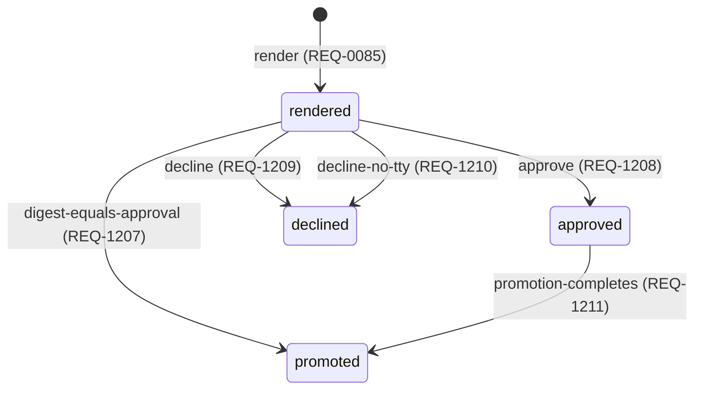

<!--
Code generated by tools/ci generate. DO NOT EDIT.
Source: internal/state (the transition table of the candidate machine)

Generated by this command:

	go generate ./...

-->

# The candidate state machine

The candidate machine of [01 1.6](../spec/01-system-model.md#candidate): an unapproved render under `.romeu/candidates/`, at most one per project. Its states are transient within one command and are never persisted.

An arrow reads `event (requirement)`. `[*]` is none: no record.

| From | Event | To | Effect | Requirement |
|---|---|---|---|---|
| `none` | `render` | `rendered` | `candidate dir written under .romeu/candidates/<candidate-id>/` | REQ-0085 |
| `rendered` | `digest-equals-approval` | `promoted` | `promotion commit` | REQ-1207 |
| `rendered` | `approve` | `approved` | `approval recorded` | REQ-1208 |
| `rendered` | `decline` | `declined` | `candidate dir deleted` | REQ-1209 |
| `rendered` | `decline-no-tty` | `declined` | `candidate dir deleted; the widening digest printed; exit 3` | REQ-1210 |
| `approved` | `promotion-completes` | `promoted` | `candidate dir deleted` | REQ-1211 |
