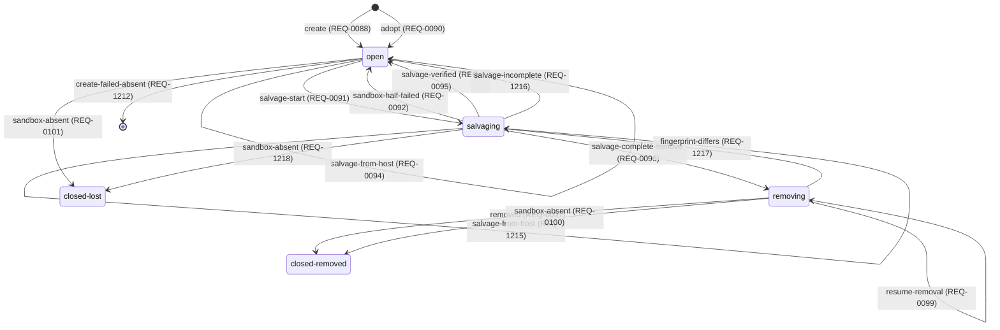

<!--
Code generated by tools/ci generate. DO NOT EDIT.
Source: internal/state (the transition table of the generation machine)

Generated by this command:

	go generate ./...

-->

# The generation state machine

The generation machine of [01 1.6](../spec/01-system-model.md#generation): one sandbox lifetime. Its five states persist in `projects/<name>.json`.

An arrow reads `event (requirement)`. `[*]` is none: no record.

| From | Event | To | Effect | Requirement |
|---|---|---|---|---|
| `none` | `create` | `open` | `generation record written: id, recreate digest, workspace path, repo set` | REQ-0088 |
| `open` | `create-failed-absent` | `none` | `the record just written removed; exit 1` | REQ-1212 |
| `open` | `create-failed-present` | `open` | `the record kept; exit 1` | REQ-1213 |
| `open` | `create-timeout` | `open` | `the record kept; exit 1` | REQ-0089 |
| `none` | `adopt` | `open` | `generation record written with adopted: true and an unknown recreate digest` | REQ-0090 |
| `open` | `salvage-start` | `salvaging` | `new salvage id` | REQ-0091 |
| `salvaging` | `salvage-restart` | `salvaging` | `new salvage id; the refs the earlier salvage created stay` | REQ-1214 |
| `salvaging` | `sandbox-half-failed` | `open` | `salvage record result: incomplete, reasons: [sandbox-half-failed]` | REQ-0092 |
| `open` | `salvage-from-host` | `open` | `refs and snapshot bundles imported under a new salvage id; salvage record result: lost, reasons: [sandbox-lost]` | REQ-0094 |
| `salvaging` | `salvage-from-host` | `salvaging` | `refs and snapshot bundles imported under a new salvage id; salvage record result: lost, reasons: [sandbox-lost]` | REQ-1215 |
| `salvaging` | `salvage-verified` | `open` | `salvage record result: complete` | REQ-0095 |
| `salvaging` | `salvage-incomplete` | `open` | `salvage record result: incomplete with reasons; exit 5` | REQ-1216 |
| `salvaging` | `salvage-complete-remove` | `removing` | `state written, with the salvage entry's fingerprint, before sbx env rm` | REQ-0096 |
| `removing` | `removed` | `closed-removed` | `egress rules removed` | REQ-0097 |
| `removing` | `remove-failed` | `removing` | `the existing salvage record kept; exit 1` | REQ-0098 |
| `removing` | `resume-removal` | `removing` | `the existing salvage record kept; the command resumes at sbx env rm` | REQ-0099 |
| `removing` | `fingerprint-differs` | `salvaging` | `new salvage id; the salvaging rows decide how that salvage ends` | REQ-1217 |
| `removing` | `sandbox-absent` | `closed-removed` | `the existing salvage record kept; egress rules removed` | REQ-0100 |
| `open` | `sandbox-absent` | `closed-lost` | `keeps a lost record salvage --from-host wrote for this generation, else writes one: result lost` | REQ-0101 |
| `salvaging` | `sandbox-absent` | `closed-lost` | `keeps a lost record salvage --from-host wrote for this generation, else writes one: result lost` | REQ-1218 |
